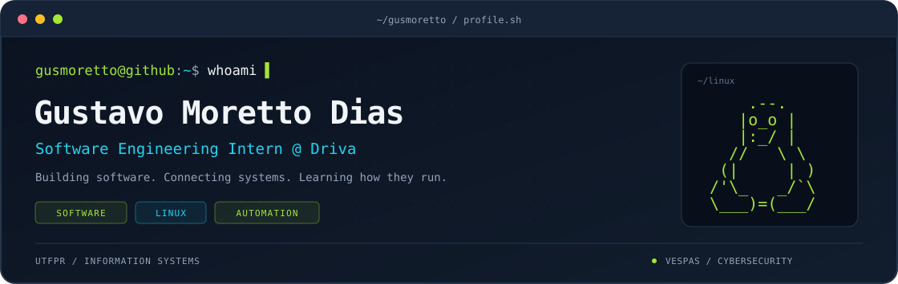

<p align="center">
  
</p>

<p align="center">
  <a href="https://www.linkedin.com/in/gustavo-moretto-dias/"></a>
  <a href="mailto:gmorettodias@gmail.com"></a>
</p>

## `$ cat about.md`

I'm **Gustavo Moretto Dias**, a **Software Engineering Intern at Driva** and an **Information Systems student at UTFPR**.

My background includes **CRM maintenance, internal systems, web development, API integration, relational databases, and automation**. I've worked with PHP and JavaScript, and expanded my experience through projects involving Node.js, Linux, Docker, and data workflows.

I'm also a member of **VESPAS**, an academic extension project focused on **cybersecurity**. I enjoy understanding how systems connect, solving practical problems, and learning how software behaves beyond the code.

## `$ tree ~/journey`

```text
~/journey
├── work/
│   └── Software Engineering Intern @ Driva
├── experience/
│   ├── CRM & internal systems
│   ├── Web applications & API integrations
│   ├── Relational databases & data workflows
│   └── Linux, containers & workflow automation
├── education/
│   └── Information Systems @ UTFPR
└── community/
    └── VESPAS / Cybersecurity
```

## `$ cat stack.yml`

```yaml
development:
  web: [PHP, JavaScript, Node.js, Express, HTML, CSS]
  academic: [C, C++]

data:
  databases: [MySQL, PostgreSQL]
  workflows: [n8n, API integration]

systems:
  environments: [Linux, Docker, Docker Compose]

collaboration:
  tools: [Git, GitLab, Jira]
  practices: [Scrum]
```

## `$ tail -n 3 learning.log`

```text
[learning]  Deepening my understanding of Linux environments.
[building]  Practicing containers and workflow automation.
[exploring] DevOps and how software is deployed and maintained.
```

<details>
  <summary><code>$ man gusmoretto</code></summary>

### NAME

Gustavo Moretto Dias — software developer, Information Systems student, and Linux enthusiast.

### INTERESTS

Software development, automation, reliable environments, and cybersecurity.

### CONTACT

[LinkedIn](https://www.linkedin.com/in/gustavo-moretto-dias/) · [Email](mailto:gmorettodias@gmail.com)

</details>

---

```console
gusmoretto@github:~$ _
```
